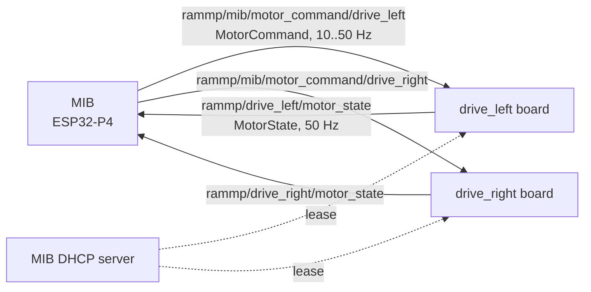
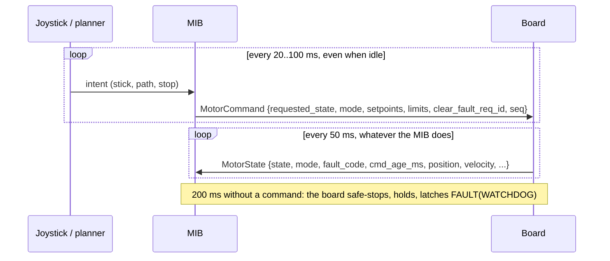
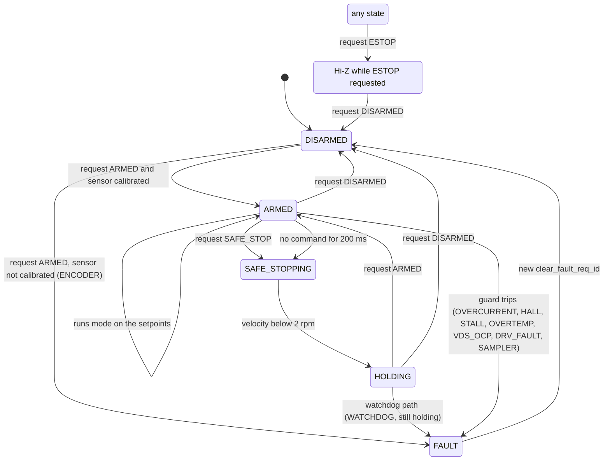
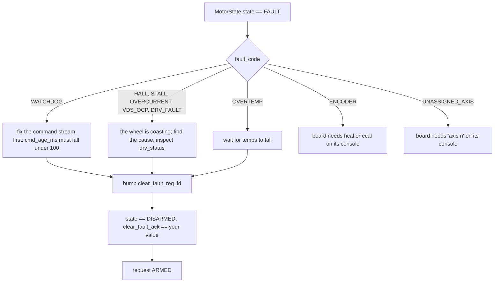
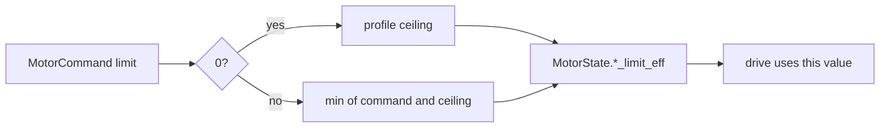

# PACE RACER motor API

How to drive a PACE RACER wheel over ATOS. The wire types are
`components/rammp_rtps_messages/include/messages/motor_message.hpp`; this
document is the behaviour behind them. The firmware that implements it lives in
`rammp-org/pace-racer-fw`, `components/pace-racer-board/atos-drive`.

Status: API version 3. Version 3 (2026-10-19) only adds a way to set a speed
gain to exactly 0 (Tuning); the wire layout is version 2's. Version 1 was verified on the bench 2026-09-26 on a
NineBot S wheel, halls only, one board. The tuning topic (version 2,
2026-10-09) builds on the board and in the host stand-in but has not been
exercised on a wheel yet. The chair's two drive boards run version 2 firmware
as of 2026-10-15. Not yet run with two boards or under load.

## Quick start: drive both wheels from the MIB

Copy this into a `main.cpp` on an ESP-IDF project that depends on `espp/rtps`
and has this repository as a component (the MIB firmware already does both).
It arms the two drive boards, streams a velocity to each at 20 Hz, checks that
they obey, and safe-stops after five seconds. Everything below this section
explains why each line is there.

```cpp
// main.cpp: the smallest MIB that drives drive_left and drive_right.
#include <atomic>
#include <chrono>
#include <cstdint>
#include <cstdio>
#include <thread>

#include "messages/motor_message.hpp"
#include "rtps_participant.hpp"
#include "rtps_pubsub.hpp"

using namespace std::chrono_literals;

namespace {

// One wheel: a command publisher, a state subscriber, the last state heard.
struct Wheel {
  const rammp::AxisSpec &axis;
  float sign; // +1 left, -1 right: forward is CCW on the left wheel only
  espp::Publisher<rammp::MotorCommand> cmd;
  espp::Subscriber<rammp::MotorState> state;
  std::atomic<rammp::BoardState> board_state{rammp::BoardState::DISARMED};
  std::atomic<rammp::FaultCode> fault{rammp::FaultCode::NONE};
  std::atomic<uint16_t> cmd_age_ms{65535};
  std::atomic<float> velocity{0.0f};

  Wheel(espp::RtpsParticipant &part, rammp::AxisId id, float sign_)
      : axis(rammp::axis(id)), sign(sign_),
        cmd(part, {.topic = axis.command.name, .type_name = axis.command.type}),
        state(part, {.topic = axis.state.name,
                     .type_name = axis.state.type,
                     .on_message =
                         [this](const rammp::MotorState &s) {
                           board_state = s.state;
                           fault = s.fault_code;
                           cmd_age_ms = s.cmd_age_ms;
                           velocity = s.velocity;
                         }}) {}

  bool ok() const { return cmd.is_valid() && state.is_valid(); }

  // Send the whole desired state. Call this every 50 ms, idle or not.
  void send(uint8_t seq, rammp::RequestedState req, float forward_rad_s) {
    rammp::MotorCommand c{};
    c.seq = seq;
    c.requested_state = req;
    c.mode = rammp::ControlMode::VELOCITY;
    c.velocity = sign * forward_rad_s;
    c.torque_limit = 0.0f; // 0 = the board's profile ceiling
    c.vel_limit = 0.0f;
    c.accel_limit = 5.0f; // rad/s^2: always ramp; a step is the first cause of shaking
    if (!cmd.publish(c))
      printf("%s: publish failed (no matched reader yet?)\n", axis.label);
  }

  // The two checks the doc says to make on every MotorState.
  bool obeying() const {
    return board_state == rammp::BoardState::ARMED && cmd_age_ms < 100;
  }
};

} // namespace

extern "C" void app_main(void) {
  // The MIB is the DHCP server for the boards, so its own address is fixed.
  // On the real MIB this comes from the ethernet netif after link-up.
  espp::RtpsParticipant part({.interface_address = "192.168.4.1"});
  if (!part.start()) {
    printf("rtps participant failed to start\n");
    return;
  }

  Wheel left(part, rammp::AxisId::DRIVE_LEFT, +1.0f);
  Wheel right(part, rammp::AxisId::DRIVE_RIGHT, -1.0f);
  if (!left.ok() || !right.ok()) {
    printf("endpoint registration failed\n");
    return;
  }

  uint8_t seq = 0;
  auto tick = [&](rammp::RequestedState req, float fwd_left, float fwd_right) {
    ++seq;
    left.send(seq, req, fwd_left);
    right.send(seq, req, fwd_right);
  };

  // 1. Arm with zero velocity until both boards report ARMED (or give up).
  for (int i = 0; i < 60 && !(left.obeying() && right.obeying()); ++i) {
    tick(rammp::RequestedState::ARMED, 0.0f, 0.0f);
    std::this_thread::sleep_for(50ms);
  }
  if (!left.obeying() || !right.obeying()) {
    // A FAULT here is usually ENCODER (board not hcal'd) or UNASSIGNED_AXIS.
    printf("not armed: left=%d fault=%d right=%d fault=%d\n", (int)left.board_state.load(),
           (int)left.fault.load(), (int)right.board_state.load(), (int)right.fault.load());
  }

  // 2. Drive forward at 2 rad/s for 5 s, both wheels, re-sending every 50 ms.
  for (int i = 0; i < 100; ++i) {
    tick(rammp::RequestedState::ARMED, 2.0f, 2.0f);
    if (i % 20 == 0)
      printf("L %.2f rad/s  R %.2f rad/s  obeying L=%d R=%d\n", left.velocity.load(),
             -right.velocity.load(), (int)left.obeying(), (int)right.obeying());
    std::this_thread::sleep_for(50ms);
  }

  // 3. Stop under control and stay held. Keep streaming: silence is a WATCHDOG fault.
  while (true) {
    tick(rammp::RequestedState::SAFE_STOP, 0.0f, 0.0f);
    std::this_thread::sleep_for(50ms);
  }
}
```

The ESP-IDF manifest it needs, `main/idf_component.yml`:

```yaml
dependencies:
  espp/rtps: '>=1.3.3'
  espp/cdr: '>=1.3'
```

and `main/CMakeLists.txt` must `REQUIRES rammp_rtps_interface` (or
`rammp_rtps_messages`) with this repository under `components/` or
`external/`. Turn the wheel the other way by negating the velocity; turn the
chair by giving the two wheels different values.

### Tuning the speed loop from scripts

`MotorTuning` is a one-shot request, not a stream, so the natural tool is a
script that sends it while something else keeps the command stream alive. The
host MIB stand-in in `pace-racer-fw`, `tests/host_mib/mib_stub`, does exactly
that: it streams `MotorCommand` at 20 Hz on its own and takes commands from
stdin, so a tuning script is a here-doc. Build it once with the CMake in that
directory; run it on a laptop plugged into the chair's switch, with the MIB
off (two MIBs commanding one axis is a bad day). The first argument is the
laptop's own address on that interface, not the board's.

`tune.sh`, the generic one. Sends a gain set, drives a step, prints the
reply once a second so you can read `tune ack=` and the gains in force:

```bash
#!/usr/bin/env bash
# usage: ./tune.sh <laptop-ip> <axis> <kp A/(rad/s)> <ki A/rad> <pll Hz> [save]
# 0 for any gain means "leave as is", negative kp/ki means exactly 0. 'save' writes to NVS.
set -eu
IP=$1; AXIS=$2; KP=$3; KI=$4; PLL=$5; SAVE=${6:-}
./build/mib_stub "$IP" "$AXIS" <<SCRIPT
tune $KP $KI $PLL $SAVE
wait 1
lim 0 0 5
arm
wait 1
vel 2
wait 3
vel 0
wait 2
stop
wait 1
disarm
q
SCRIPT
```

Then follow the order in the Tuning section:

```bash
./tune.sh 192.168.4.10 drive_left 2.39 4.77 10     # the hall defaults
./tune.sh 192.168.4.10 drive_left 2.39 2.4 10      # step 2: halve ki
./tune.sh 192.168.4.10 drive_left 1.2 2.4 10       # step 3: halve kp
./tune.sh 192.168.4.10 drive_left 1.2 2.4 5        # step 4: smoother feedback
./tune.sh 192.168.4.10 drive_left 0 -1 0           # integrator off (ki exactly 0), rest unchanged
./tune.sh 192.168.4.10 drive_left 1.2 2.4 5 save   # keep it across reboots
./tune.sh 192.168.4.10 drive_right 1.2 2.4 5 save  # the other wheel is its own board
```

`sweep_ki.sh`, for finding the edge. Holds `kp` and `pll`, steps `ki`, and
records every `MotorState` so the runs can be compared after the fact:

```bash
#!/usr/bin/env bash
# usage: ./sweep_ki.sh <laptop-ip> <axis> <kp> <pll>   -> logs/ki_<value>.log
set -eu
IP=$1; AXIS=$2; KP=$3; PLL=$4
mkdir -p logs
for KI in 1.0 2.0 3.0 4.77 6.0; do
  echo "== ki=$KI"
  ./build/mib_stub "$IP" "$AXIS" -v > "logs/ki_${KI}.log" <<SCRIPT
tune $KP $KI $PLL
wait 1
lim 0 0 5
arm
wait 1
vel 2
wait 3
vel 0
wait 2
stop
wait 1
disarm
q
SCRIPT
  awk '/vel=/ { n++ } /fault=(STALL|OVERCURRENT|HALL)/ { f++ } END { printf "samples=%d faults=%d\n", n, f+0 }' \
    "logs/ki_${KI}.log"
done
```

Judge a run by `vel=` settling at 2 without overshoot in the log, and by the
wheel not buzzing. If a run latches a fault, add `clr` then `arm` to the
script before the next step; `mib_stub` bumps the clear counter for you.

From the MIB itself the same request is one struct on the tuning topic. Add
a tuning publisher and a request counter to the `Wheel` above:

```cpp
// In Wheel, declared after `state`:
//   espp::Publisher<rammp::MotorTuning> tune;
//   uint8_t tune_req{0};
// and last in the constructor's initializer list:
//   tune(part, {.topic = axis.tuning.name, .type_name = axis.tuning.type})
void send_tuning(Wheel &w, float kp, float ki, float pll_hz, bool persist) {
  rammp::MotorTuning t{};
  t.tuning_req_id = ++w.tune_req; // the board acts on a NEW value only
  t.persist = persist ? 1 : 0;
  t.speed_kp = kp;                // 0 = leave as is, < 0 = exactly 0
  t.speed_ki = ki;
  t.hall_pll_hz = pll_hz;
  w.tune.publish(t);
  // Best effort: watch MotorState.tuning_ack == t.tuning_req_id and read
  // speed_kp / speed_ki / hall_pll_hz back; resend if it did not take.
}
```

Call it once when a value changes. The gains apply on the next 10 ms tick
without resetting the integrator, so it is safe under way.

## One wheel, three topics

Each board is one wheel. It reads two topics and writes one. Nothing else
crosses the wire: no calibration, no limit ceilings, no services.

| direction | topic | type | rate |
| --- | --- | --- | --- |
| MIB to board | `rammp/mib/motor_command/<axis>` | `rammp::MotorCommand`, 28 bytes | streamed by the MIB, 10 to 50 Hz |
| board to MIB | `rammp/<axis>/motor_state` | `rammp::MotorState`, 92 bytes | 50 Hz, always, armed or not (20 Hz before pace-racer-fw `ab44267`) |
| MIB to board | `rammp/mib/motor_tuning/<axis>` | `rammp::MotorTuning`, 16 bytes | when a gain changes; see Tuning |

`<axis>` is `front_caster_left`, `front_caster_right`, `drive_left` or
`drive_right` (`RAMMP_AXIS_TABLE`, `rammp::kAxes`). A board only deserializes
its own command topic.



The transport is best effort with no durability. Every command therefore
carries the complete desired state, so a lost packet costs nothing: the next
one repeats it. The one exception is the fault clear, which is a counter, so a
repeated packet cannot clear a fault twice.

The C++ structs are the wire layout. Use the header with espp's reflection on
both ends; do not transcribe offsets. `MotorState` has 2 bytes of XCDR1 padding
before `cmd_age_ms`.

## The loop you write



Two things the MIB should assert on every `MotorState`:

- `state == ARMED` while it believes it is driving. Any other state means the
  board is ignoring `mode` and the setpoints.
- `cmd_age_ms < 100`. It reads 20 to 50 ms on a healthy stream; 65535 means the
  board has never heard from you.

Record every `MotorState`. At 92 bytes and 50 Hz a wheel is 4.6 kB/s, and an
incident with a recording is a replay.

## MotorCommand

Send the whole struct every time.

| field | type | meaning |
| --- | --- | --- |
| `seq` | uint8 | your counter; echoed back as `last_cmd_seq` |
| `requested_state` | enum | `DISARMED`, `ARMED`, `SAFE_STOP`, `ESTOP`. The board converges to it every 10 ms tick |
| `mode` | enum | `COAST`, `TORQUE`, `VELOCITY`, `POSITION`, `HOLD`. Ignored unless ARMED |
| `position` | float, rad | POSITION setpoint at the shaft, multiturn, CCW positive. Every new value is a new target, no profile |
| `velocity` | float, rad/s | VELOCITY setpoint at the shaft |
| `torque` | float, N.m | TORQUE setpoint at the shaft |
| `torque_limit` | float, N.m | 0 = profile ceiling. Clamps `torque`, caps current in every mode |
| `vel_limit` | float, rad/s | 0 = profile ceiling. Clamps the velocity setpoint, caps position moves, rolls torque off above it in every mode |
| `accel_limit` | float, rad/s^2 | 0 = step, or the profile's acceleration ceiling where one is set. Ramps the velocity setpoint and the safe stop |
| `clear_fault_req_id` | uint8 | a counter. Bump it once to clear a fault; the board acks the value it acted on |

Units are SI at the shaft. Pole pairs, gearing and Kt are the board's business.

Sign: CCW is positive for position, velocity and torque, as seen from outside
the chair looking at the wheel face, right-hand thumb pointing outboard along
the axle. Every board uses the same rule, so driving forward the left wheel
is positive and the right wheel negative. The MIB negates the mirrored side;
there is no direction flag on the board.

A joystick controller sends `ARMED` + `VELOCITY` + the stick value, limits at
0, counter unchanged. Stick released: `SAFE_STOP`. Done for the day: `DISARMED`.

## What each mode does

| mode | setpoint used | the board runs | notes |
| --- | --- | --- | --- |
| `COAST` | none | bridge Hi-Z, wheel free | the mode to send while ARMED with nothing to do |
| `TORQUE` | `torque` | current loop at `torque / Kt` | above `vel_limit` torque rolls off and reverses: it cannot run away |
| `VELOCITY` | `velocity` | speed loop, setpoint ramped at `accel_limit` | the mode the chair and the rover drive in |
| `POSITION` | `position` | position P loop feeding the speed loop, capped at `vel_limit` | on halls, position moves in hall steps: 4 deg on 15 pole pairs, 3 deg on the 20-pole-pair hub |
| `HOLD` | none | position hold at the shaft's current angle | reduced torque cap; also what SAFE_STOP ends in |

## The state machine



| you request | from | the board does |
| --- | --- | --- |
| `ARMED` | DISARMED, HOLDING | uncoasts and runs `mode`. Refused with `FAULT(ENCODER)` if the commutation sensor is not calibrated |
| `SAFE_STOP` | ARMED | ramps velocity to zero at `accel_limit` (200 rpm/s if 0), then HOLDING: active position hold under a reduced torque cap. It stays held until you ask for something else |
| `DISARMED` | anything | Hi-Z, wheel free |
| `ESTOP` | anything | Hi-Z now, and for as long as you keep requesting it |
| nothing for 200 ms | ARMED | the SAFE_STOP path, then `FAULT(WATCHDOG)` while still holding |

Two consequences. A chair that loses its MIB ends up held. SAFE_STOP is a
stop, and ARMED is allowed from HOLDING, so resuming is one request away.

Why ESTOP coasts instead of holding: a hold is an active control loop driving
current through the bridge on the strength of a sensor, and ESTOP exists for
the case where you no longer trust the drive, its sensor or its software.
The only state that cannot push the chair is the bridge off, so that is what
ESTOP does, immediately and for as long as it is requested. Holding is the job
of SAFE_STOP, which is the normal way to stop: the wheel is brought to rest
under control and then held, including on a slope, and the chair's own brakes
or a power-off take over from there. Treat ESTOP as "cut power to the
wheels", not as "stop quickly"; on a hill a chair under ESTOP will roll until
its mechanical brake catches it. The MIB decides which one the red button
means; the recommendation is SAFE_STOP for the button and ESTOP for faults
the MIB detects in the drive itself.

## Faults and how to clear them

A fault latches until `clear_fault_req_id` changes. The board then goes to
DISARMED and reports the counter value in `clear_fault_ack`; request ARMED from
there. Clearing when not faulted is harmless and still acks.



| fault | cause | the wheel |
| --- | --- | --- |
| `WATCHDOG` | no command for 200 ms | safe-stopped, then held |
| `OVERCURRENT` | phase current over the board trip | unloaded, coast |
| `VDS_OCP`, `DRV_FAULT` | gate driver tripped; bits in `drv_status` | bridge off |
| `OVERTEMP` | a board temperature over its limit; see `temps` | unloaded, coast |
| `ENCODER` | arm requested with an uncalibrated commutation sensor | never energized |
| `SAMPLER` | current sampling fell behind and disabled itself | coast |
| `HALL` | illegal hall input for 50 ms: an open, shorted or unpowered line | unloaded, coast, within one sample |
| `STALL` | speed or position mode pushing at half the cap with no hall motion for 0.5 s | unloaded, coast, about 2 s after a wheel is blocked |
| `UNASSIGNED_AXIS` | no axis in NVS | not on the network |

## Limits and profiles

Every limit in a command is clamped to the board's profile, and the value in
force comes back in `*_limit_eff`. Read those rather than assuming.



| limit | 0 means | the drive does |
| --- | --- | --- |
| `torque_limit` | ceiling | caps current in every mode; clamps `torque` |
| `vel_limit` | ceiling | clamps the velocity setpoint and position moves; in every mode a governor rolls torque off above it and brakes, so a wound-up controller or a torque command cannot run a wheel away |
| `accel_limit` | step, or the ceiling on profiles that set one | ramps the velocity setpoint and the safe stop |

A profile is a block of compile-time constants in the firmware,
`main/motor_params.hpp` in `atos-drive`, selected with `idf.py
-DATOS_MOTOR=<profile> build`. It holds the motor (pole pairs, Kt, R, L,
flux), the current-loop tune, and the ceilings. The ceilings exist so that
nothing on the network can raise them; the integration team owns them.

| profile | motor | speed ceiling | current ceiling | accel ceiling |
| --- | --- | --- | --- | --- |
| default | NineBot S on the dyno | 520 rpm (54.5 rad/s) | 30 A (18 N.m) | none |
| `flatbot` | NineBot S on the office rover | 60 rpm (6.28 rad/s) | 10 A (6 N.m) | 120 rpm/s (12.6 rad/s^2) |
| `hub20` | ZLtech hub on rammp 1.5 (constants measured 2026-09-24: Kt 1.56 N.m/A) | 180 rpm (18.8 rad/s) | 22 A (34 N.m) | none |

The flatbot numbers are a starting point. The integration team characterizes
the robot with them, decides what is safe for it, edits the profile, and
reflashes. Feel is then tuned from the MIB with the per-command limits, which
can only tighten a ceiling, so tuning from the MIB cannot make the robot
faster or stronger than its profile.

## Tuning

API version 2 (2026-10-09). The outer speed loop and the hall speed estimator
can be tuned from the MIB, live, so a robot that shakes can be calmed without
a laptop on the board. `MotorTuning` is a request, not a stream: send it when
a value changes, then watch `tuning_ack` and the three gain fields in
`MotorState` to see what took.

| field | unit | 0 means | the board does |
| --- | --- | --- | --- |
| `tuning_req_id` | counter | | acts on a NEW value only, echoes it as `tuning_ack`. Resend the same message freely |
| `speed_kp` | A per rad/s | unchanged | proportional gain of the velocity loop, clamped to the profile range. Negative: exactly 0 |
| `speed_ki` | A per rad | unchanged | integral gain, clamped. Negative: exactly 0, integrator off and emptied |
| `hall_pll_hz` | Hz | unchanged | bandwidth of the tracking loop that turns hall edges into velocity, 0.5 to 50 |
| `persist` | 0 / 1 | until reboot | 1 also writes the values to NVS; they come back at the next boot |

The change is applied on the next supervisor tick, in every state, without
resetting the integrator: under way it is a change of slope, not a bump. The
board clamps each value into a compile-time range and reports the values in
force in `MotorState.speed_kp`, `speed_ki`, `hall_pll_hz`, so read those
rather than assuming. Those three fields are always valid, tuned or not: they
are the defaults until a MotorTuning changes them.

To switch a term off, send a negative value: `speed_ki = -1` sets the
integral gain to exactly 0 (version 3; 0 itself keeps meaning "leave as is",
so a message that only touches one gain stays safe). With `speed_ki` at 0
the board also holds the integrator at 0, so whatever current it was
supplying goes away at once: under load, for example on a slope, that is a
torque step until the proportional term catches up. Send it stopped if that
matters. `speed_kp` can go to 0 the same way. A tiny positive value such as
0.0001 is NOT the same thing: it is clamped and applied, and the integrator
keeps what it holds. A version 2 board ignores a negative value; check
`MotorState.api_version >= 3`, and read `speed_ki` back either way.

What to send for a vibrating robot, in order:

1. Nothing yet. Put a real `accel_limit` in every `MotorCommand` first; a
   stepped velocity reference under a 0.5 integrator is the first suspect.
2. Halve `speed_ki`. The integrator supplies breakaway current and is what
   bounces after a step.
3. Halve `speed_kp`.
4. Lower `hall_pll_hz` toward 5 for smoother velocity feedback at the cost of
   lag, or raise it toward 20 if the loop hunts slowly.

Defaults on halls, every profile (tuned on the NineBot 2026-09-28):
`speed_kp` 2.39 A per rad/s, `speed_ki` 4.77 A per rad, `hall_pll_hz` 10. The
hub motor makes 2.6 times the torque per amp, so expect to soften these on
the chair. On the console these print as
0.25 A/rpm and 0.5 A/rpm-s; the wire is SI like everything else.

The current loop, the limit ceilings, the calibration and the motor
constants are not on the wire. Those are the profile's and the console's.

## What you cannot do

- Raise a ceiling from the network. Edit the profile and reflash.
- Change the current loop, calibration or motor constants from the network.
  Console and NVS only. The speed loop and hall PLL are the exception, above.
- Send a trajectory. Stream setpoints; the board tracks each one as fast as
  the limits allow. Profiling is the MIB planner's job. This does not stop a
  task module from driving the chair on its own: it sends VELOCITY (or
  POSITION) setpoints at 10 to 50 Hz, each one the value the wheel should
  have right now, and the board follows. What the board will not do is
  interpolate between two sparse targets, so a planner that computes a path
  has to stream it as it goes, the same way a joystick streams stick
  positions. Odometry comes back in `position` at 50 Hz.
- Rely on a single command. Anything you send once may be lost; keep
  streaming the state you want.
- Pause. SAFE_STOP ends in an active hold; ARMED resumes.
- Coast on a hill after a safe stop. If you want the wheel free, request
  DISARMED and mean it.

## MotorState

| field | type | what to watch |
| --- | --- | --- |
| `state`, `mode`, `fault_code` | enums | the three that say whether you are being obeyed |
| `cmd_age_ms` | uint16 | time since the last command; 65535 = never |
| `last_cmd_seq`, `clear_fault_ack` | uint8 | your `seq` and your clear counter as the board saw them |
| `position` | float, rad | shaft, multiturn from boot, CCW positive |
| `velocity` | float, rad/s | shaft, from the commutation sensor. On halls a 5 Hz tracking loop |
| `torque_est`, `iq`, `id` | float | torque from Kt times `iq`; `id` should sit near zero |
| `vbus`, `ibus_est`, `temps[4]` | float | bus volts, an estimate of bus current, board temperatures in C |
| `torque_limit_eff`, `vel_limit_eff`, `accel_limit_eff` | float | the limits in force |
| `tuning_ack` | uint8 | your last `tuning_req_id` as the board saw it |
| `speed_kp`, `speed_ki`, `hall_pll_hz` | float | the outer-loop tune in force, SI |
| `drv_status` | uint16 | raw DRV8353 fault bits, meaningful with `VDS_OCP` and `DRV_FAULT` |
| `api_version`, `fw_version`, `axis_id`, `uptime_ms`, `seq` | ints | identity and liveness |

## Discovery, and what the MIB should do about it

The board asks the MIB for a DHCP lease with hostname `pace-racer-<axis>`,
starts its RTPS participant on the leased address, and publishes from then on.
Two findings from the bench that the MIB should design around:

- A switch with IGMP snooping and no querier forwarded the host's multicast to
  the board but not the board's to the host, so SPDP discovery failed one way
  and everything looked dead. The MIB is the DHCP server and knows every
  board's address from its lease table. Discover boards by unicast from that
  table instead of relying on multicast.
- On the espp rtps the firmware was first verified with (1.2.0), the board
  kept the reader proxy of every host participant it ever matched and they did
  not expire, so each MIB restart added one more copy of every `MotorState`
  the board sent into a fixed-size table. espp rtps 1.3.3, which the firmware
  builds with since 2026-10-09, expires remote participants whose SPDP lease
  lapses and removes their proxies from every endpoint. The chair firmware
  therefore no longer has the leak by design, but the MIB-restart case has
  not been re-run on the bench since the upgrade; do that before depending on
  it.

The MIB also owns the deadman above this API: joystick released means
`SAFE_STOP`; joystick board silent means stop requesting `ARMED`, so both
wheels watchdog into a hold within 200 ms.

## Bringing up a board

Once per board, on its console, before it will arm:

```
axis 2      # 0 front_caster_left, 1 front_caster_right, 2 drive_left, 3 drive_right
fb hall     # what it commutates on: hall (default) or enc
hcal 6      # hall table, spun both ways on a free wheel; ecal 4 for an encoder
```

`axis` shows what is saved, `fb` shows the sensor and whether it is calibrated,
`atos` shows the link, the state machine and the counters.

A board inside a wheel has no reachable USB port, so since 2026-10-15 the
firmware also serves its console, firmware update and reset over the same
ethernet it talks ATOS on: a framed stream on tcp :5555 and a discovery
responder on udp :5556 (send `PACE?`, get one JSON line back with the axis,
firmware and calibration state). Nothing about this crosses the ATOS topics.
The tools are in `pace-racer-fw/components/pace-racer-board/atos-drive/tools`:
`dashboard.html` (a browser page, over WebUSB or through `eth_bridge.py`),
`eth_link.py` and `provision.py --host`. A board's first flash with firmware
that has this server still goes over USB. A host-side MIB stand-in that
streams commands from stdin and prints state is in `tests/host_mib`.
